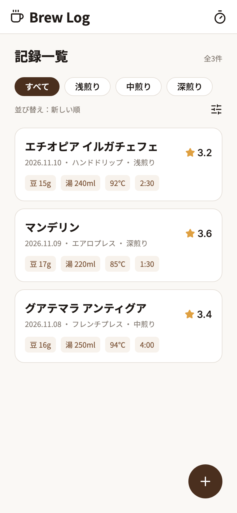
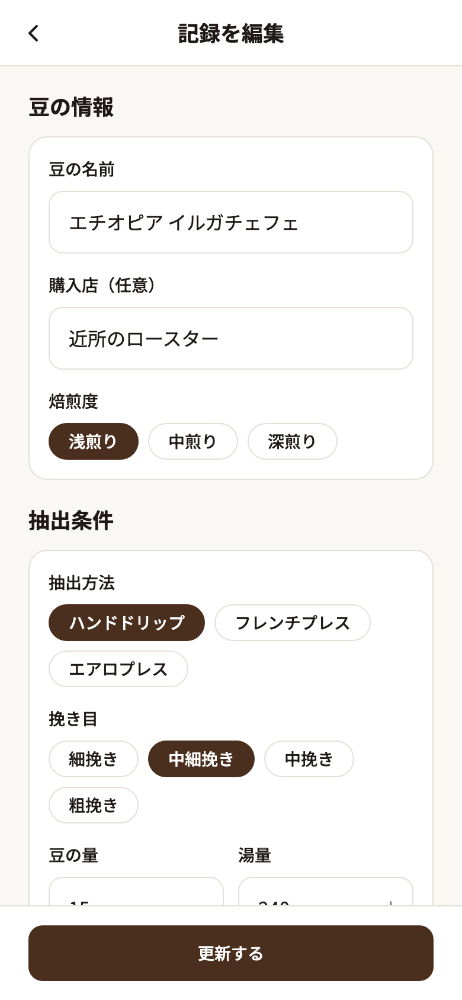
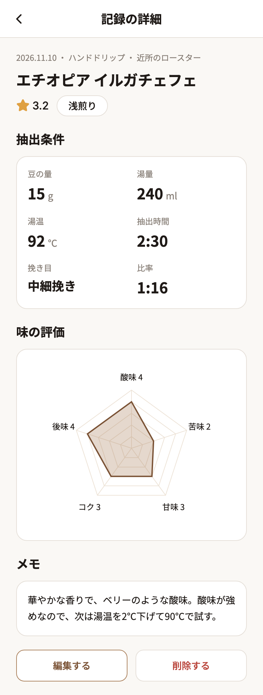
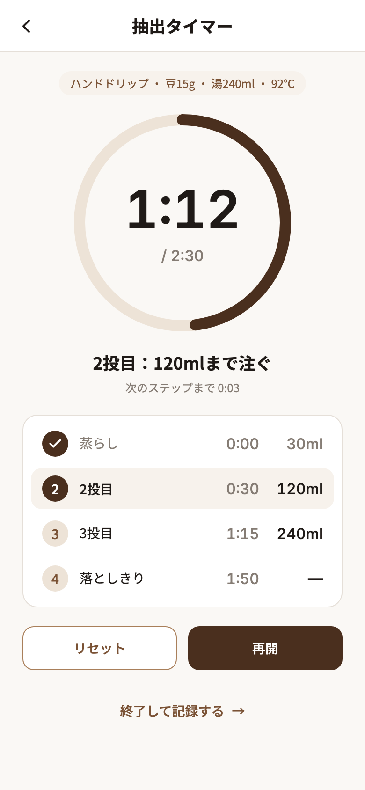

# Brew Log

自分で淹れたコーヒーの抽出条件と味を記録する Web アプリです。
豆の量・湯温・抽出時間と、酸味や苦味などの評価を残し、レーダーチャートで味を振り返れます。抽出タイマーで計った時間は、そのまま記録フォームに入ります。

<p>
  
  
  
  
</p>

## 主な機能

| 画面 | URL | できること |
| --- | --- | --- |
| 記録一覧 | `/` | 記録をカードで一覧表示。焙煎度で絞り込み、新しい順・古い順・評価が高い順で並び替え |
| 記録フォーム | `/brews/new` | 豆の情報・抽出条件・味の評価（5項目×5段階）・メモを入力。入力チェックつき |
| 記録の詳細 | `/brews/:id` | 抽出条件、豆と湯の比率、味のレーダーチャート、メモを表示。編集と削除 |
| 記録の編集 | `/brews/:id/edit` | フォームは新規作成と共通 |
| 抽出タイマー | `/timer` | ハンドドリップの手順（蒸らし→2投目→3投目→落としきり）に沿って進むタイマー。終了すると抽出時間つきでフォームへ |

## 技術構成

| 領域 | 採用 | 選んだ理由 |
| --- | --- | --- |
| ビルド | Vite + React 19 + TypeScript | サーバー処理が無いアプリなので、Next.js ではなく軽い Vite を選択 |
| ルーティング | React Router v8 | 絞り込みの状態も URL（`?roast=` / `?sort=`）に持たせ、再読み込みや「戻る」で状態が残るようにした |
| スタイル | CSS Modules + CSS 変数 | CSS 設計そのものを見せたかったため、Tailwind は使わずに自分でトークンと部品を設計 |
| フォーム | React Hook Form + Zod | 入力チェックのルールを Zod の1か所にまとめ、型もそこから作る |
| グラフ | Recharts | 味のレーダーチャート。詳細画面を開いたときに初めて読み込む（遅延読み込み） |
| データ保存 | localStorage | まずは画面づくりに集中するため。保存処理は `useBrews` フックに閉じ込めてあり、将来 Supabase などに替えるときも画面側は変えずに済む |
| アイコン | lucide-react | Figma で使ったアイコンと同じセット |
| テスト | Vitest + Testing Library | フック・入力チェック・フォームの操作をテスト |
| CI | GitHub Actions | プッシュのたびに lint・型チェック・テスト・ビルドを実行 |

## 設計で工夫した点

### デザインと CSS

- Figma でデザインを作り、**Figma Variables と CSS 変数を1対1で対応**させた（[`src/styles/tokens.css`](src/styles/tokens.css)）。
- トークンは2層。`--primitive-*`（生の色の値）と `--color-*`（「背景」「エラー文字」などの役割）に分け、部品からは役割のほうだけを使う。
- 部品は自分の外側の余白を持たず、間隔は並べる側が `gap` で決める。どこに置いても崩れない部品にするため。
- 文字サイズは rem で指定し、ブラウザの文字サイズの設定に追従させた。

### アクセシビリティ

- 焙煎度や味の評価は、見た目は Chip やバーだが、**中身は本物のラジオボタン**。矢印キーで選べて、読み上げソフトには「ラジオボタン、2/3、選択済み」と伝わる。
- 入力エラーは `aria-invalid` と `aria-describedby` で入力欄に結びつけ、保存を押すと最初のエラーの欄にフォーカスが移る。
- 削除の確認は HTML の `<dialog>`。背面の操作のブロック、フォーカスの閉じ込め、Esc キーで閉じる動作をブラウザに任せた。最初のフォーカスは「キャンセル」に置き、うっかり削除を防ぐ。
- レーダーチャートは見た目用とし、読み上げソフト向けには点数の一覧を別に用意した。
- タイマーは毎秒の変化を読み上げず、ステップが変わったときだけ `aria-live` で知らせる。
- 押せる範囲は 44×44px 以上。見た目の小さい Chip やバーは、疑似要素で押せる範囲だけを広げている。

### ロジック

- フォームの値は入力中は文字列のまま扱い、Zod で「チェック＋数値への変換」を行う。全角の数字やコロン（`１５`、`２：３０`）も受け付ける。
- タイマーは `setInterval` の回数ではなく、開始時刻との差で経過時間を計算する。タブが裏に回って処理が遅れても、時間がずれない。
- 編集で任意項目（購入店）を空にしたときに古い値が残る不具合を見つけて直し、再発防止のテストを入れた。

## フォルダ構成

```text
src/
├─ styles/       全体に効く CSS（tokens / reset / base）
├─ components/   部品。<Name>/<Name>.tsx と <Name>.module.css を隣に置く
├─ layouts/      画面の骨組み（ヘッダーと main）
├─ pages/        画面。部品を並べる
├─ hooks/        useBrews（記録の保存）、useStopwatch（タイマー）
├─ lib/          入力チェック、絞り込み・並び替え、表示用の整形、タイマーのレシピ
├─ types/        記録データの型と選択肢
└─ test/         テストの共通設定
```

## 開発の進め方

- 作業を GitHub の Issue に分け（14個）、1 Issue = 1 ブランチで進めた。
- コミットメッセージは `feat: 説明 (#Issue番号)` の形。

## 動かし方

Node.js 24 で動作を確認しています。

```bash
npm install
npm run dev      # 開発サーバー（http://localhost:5173）
npm test         # テスト
npm run lint     # ESLint
npx tsc -b       # 型チェック
npm run build    # 本番ビルド
```

## 今後やりたいこと

- ダークモード（Figma の Variables に Dark モードを追加してから）
- 抽出方法ごとのタイマーのレシピ（今はハンドドリップのみ）
- Supabase への保存と、複数の端末での同期

## クレジット

- リセット CSS は [destyle.css](https://github.com/nicolas-cusan/destyle.css)（MIT License）をもとにしています。
